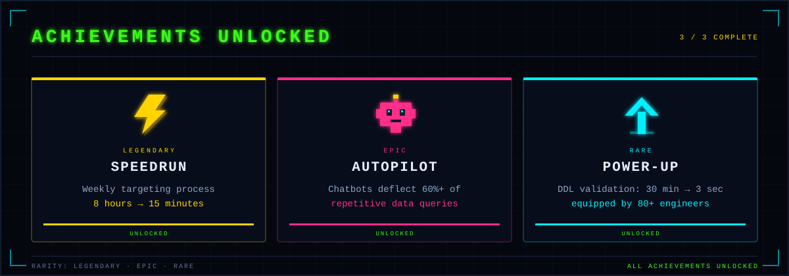

  

  
  
  
  

---

## &gt;&gt; PRESS START

I'm **Aryaman** — a data and product analyst at **Eli Lilly and Company**. I build analytics products people actually open on Monday morning: not just dashboards, but the pipelines, logic and interfaces that turn a 3-day report backlog into a 30-second self-serve answer.

---

## PLAYER PROFILE

  

---

## QUEST LOG

  

---

## ACHIEVEMENTS UNLOCKED

  

---

## SKILL TREE

  

---

## BONUS LEVEL: SNAKE

Every night a snake eats my contribution graph. It has not beaten the high score yet.

  

---

## PLAYER STATS

  

  
  

---

## SAVE POINT

  

  
  
  

