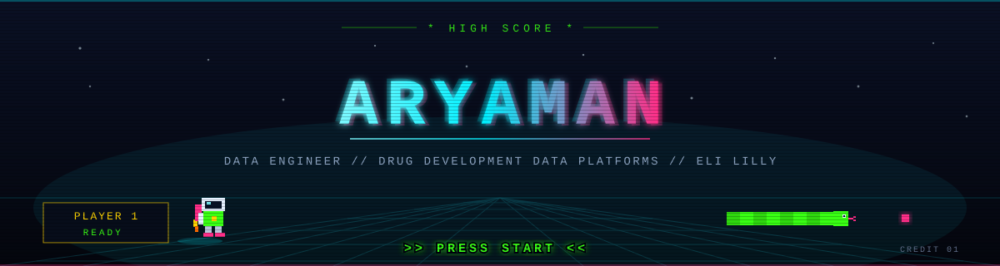
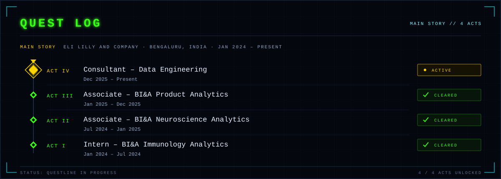
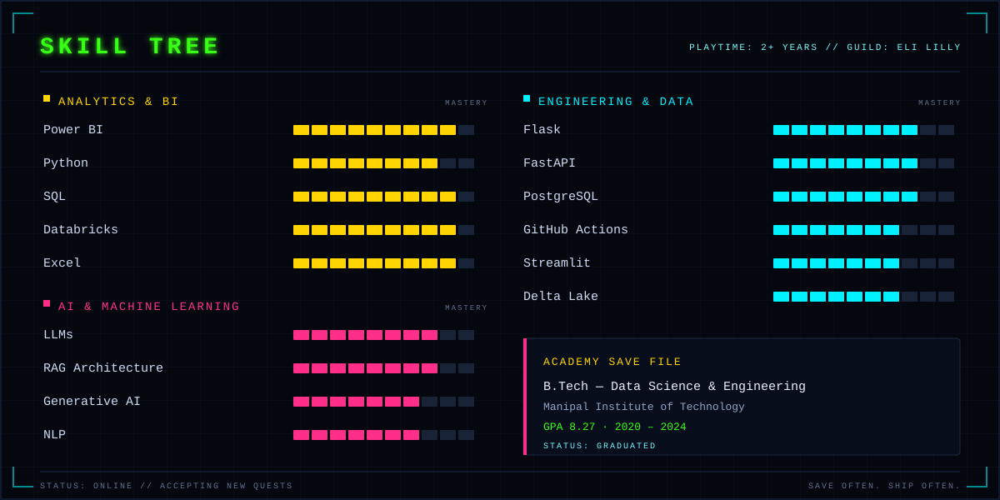
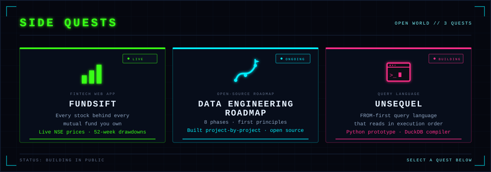
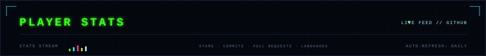
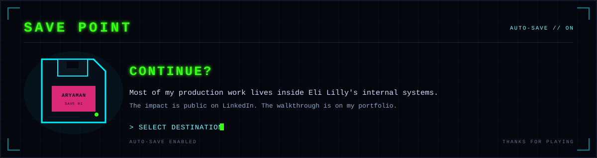

  

  
  
  
  

---

## &gt;&gt; PRESS START

I'm **Aryaman** — a data engineer at **Eli Lilly and Company**. I build governed data pipelines and AI-assisted engineering workflows for drug development: DDL validation, atomic Delta Lake migrations, and automated monitoring across ~5B records and 10+ data products — turning manual, multi-hour processes into minutes.

---

  

---

  

---

  

---

  

---

  

  
  
  

---

## BONUS LEVEL: SNAKE

Every night a snake eats my contribution graph. It has not beaten the high score yet.

  

---

  

  
  

---

  

  
  
  

